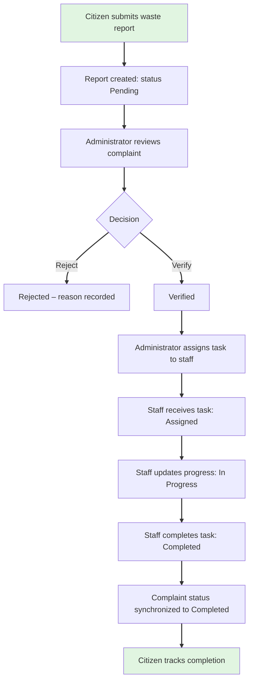

# EcoTrack – Smart Waste Management System

[](https://www.python.org/)
[](https://flask.palletsprojects.com/)
[](https://www.mysql.com/)
[](https://www.sqlalchemy.org/)
[](https://flask-migrate.readthedocs.io/)
[](https://flask-login.readthedocs.io/)
[](https://flask-wtf.readthedocs.io/)
[](https://pyinstaller.org/)
[](https://docs.pylonsproject.org/projects/waitress/)
[](https://docs.pytest.org/)
[](https://www.uttaranchaluniversity.ac.in/)

A responsive, role-based web platform that organizes the reporting and monitoring of local waste-related issues. Citizens can submit waste complaints with evidence, administrators can review and assign collection tasks, and collection staff can track and update task progress.

**Academic prototype.** Developed as a BCA final-year project at Uttaranchal University. It is not integrated with any live municipal authority or waste collection service, and it is not claimed to be production-ready.

---

## Table of Contents

- [Project Title and Introduction](#project-title-and-introduction)
- [Project Overview](#project-overview)
- [Key Features](#key-features)
- [User Roles and Workflow](#user-roles-and-workflow)
- [Technology Stack](#technology-stack)
- [System Architecture](#system-architecture)
- [Project Directory Structure](#project-directory-structure)
- [Database Design](#database-design)
- [Security Features](#security-features)
- [Installation – Source Code](#installation--source-code)
- [Database Migrations](#database-migrations)
- [Running the Application](#running-the-application)
- [Testing](#testing)
- [Windows Executable Distribution](#windows-executable-distribution)
- [Troubleshooting](#troubleshooting)
- [Documentation](#documentation)
- [Project Limitations](#project-limitations)
- [Future Enhancements](#future-enhancements)
- [Contribution and Academic Information](#contribution-and-academic-information)
- [License](#license)
- [Acknowledgements](#acknowledgements)

---

## Project Title and Introduction

**EcoTrack – Smart Waste Management System**

### Problem

In many communities, residents lack a single structured channel to report unattended waste, overflowing bins, or improper disposal, and then follow the progress of their reports. Manual calls or informal messages do not consistently capture photographs, waste category, exact location, assigned staff member, or completion status. Administrators struggle to prioritize reports, distribute collection tasks, and prepare performance summaries from scattered records.

### Proposed Solution

EcoTrack provides a centralized digital workflow:

1. **Citizens** submit waste reports (category, description, photograph, location) and track their own submissions through status updates.
2. **Administrators** review, verify, or reject reports, assign collection tasks to staff, manage waste categories and awareness articles, and view analytics and CSV reports.
3. **Collection staff** view assigned tasks and update progress and completion status.

Every important action (verification, rejection, assignment, progress update, completion) is recorded with the responsible user and timestamp, creating an auditable trail.

### Academic Prototype Notice

This application is an **academic prototype** developed for a BCA final-year project. It is a demonstration of full-stack web development (Flask, MySQL, SQLAlchemy, Bootstrap, Jinja2) and is **not** connected to live municipal authorities or waste collection services unless the code proves otherwise. AI waste classification, IoT bins, GPS tracking, rewards, SMS/email notifications, and mobile applications are explicitly future scope.

---

## Project Overview

| Aspect | Details |
|--------|---------|
| **Purpose** | Centralized platform for reporting, reviewing, assigning, and tracking waste-related complaints. |
| **Scope** | User registration/login/profile (Citizen public; Staff and Administrator provisioned securely), citizen waste reporting with image upload, administrator review and task assignment, staff task progress updates, citizen status tracking, administrator dashboard and analytics, waste category and awareness-article management. |
| **Target users** | Citizens (residents), Administrators (municipal/system administrators), Collection Staff (waste collection workers). |
| **Key objectives** | Digital reporting with evidence capture, centralized records, role-based access control, task coordination, progress tracking, performance monitoring via charts and CSV exports, environmental awareness content. |
| **Expected outcomes** | A demonstrable, test-covered web application with role-based dashboards, complaint lifecycle management, private image access, database migrations, and a packaged Windows executable. |

---

## Key Features

All features below are implemented in the source code. No features are claimed that do not exist in the repository.

### Citizen Portal
- Register, log in, log out, update profile, and change password.
- Submit a waste complaint with category, description, address, optional coordinates, and an image upload (max 5 MB, validated file types).
- Receive a unique report reference (e.g. `ET-…`) on submission.
- View own complaint history and track the status of individual complaints, including status history.

### Administrator Dashboard
- Role-restricted dashboard with complaint and task statistics.
- Review all complaints; search by reference; filter by category, status, and date range.
- Verify or reject complaints (rejection requires a mandatory reason).
- Assign a verified complaint to a collection staff member with a due date and instructions.
- Manage staff accounts (add, edit, activate/deactivate) — staff accounts are provisioned by administrators, not via public registration.
- Manage waste categories (add, edit, delete, toggle active; categories in use cannot be deleted).
- Manage awareness articles (create, edit, publish/unpublish, delete).
- View analytics charts and download CSV reports (complaint register, pending complaints, category-wise, location-wise, staff workload, task completion, monthly activity).

### Collection Staff Portal
- Role-restricted staff dashboard with assigned-task statistics.
- View only tasks assigned to the logged-in staff member; search and filter by status.
- Update task progress through the workflow (`Assigned → In Progress → Completed`) with remarks.
- Task completion records the completion timestamp and synchronizes the related complaint status.

### Complaint Management
- Full complaint lifecycle: `Pending → Verified → Rejected` or `Pending → Verified → Assigned → In Progress → Completed`.
- Status changes recorded in `report_status_history` with previous status, new status, updated-by user, timestamp, and remarks.
- Administrators can view all complaints; citizens view only their own.

### Waste Category Management
- Administrators maintain a list of waste categories (name, description, active flag).
- Only active categories appear in the citizen complaint form.
- Default categories can be seeded via a Flask CLI command.

### Task Assignment
- Administrators assign verified complaints to staff with a target due date and instructions.
- Creates a `CollectionTask` linked to the report, the assigned staff member, and the assigning administrator.
- Staff can only view and update tasks assigned to their own account.

### Complaint Status Tracking
- Citizens track complaint status and history on the complaint detail page.
- Administrators and assigned staff can view complaint details and associated images (authorized only).

### Image Uploads
- Complaint photographs validated by extension and detected content type (png, jpg, jpeg, gif, webp).
- Max upload size: 5 MB (`MAX_CONTENT_LENGTH`).
- Server-generated safe filenames (`secrets.token_hex(16)` + extension).
- Images stored outside the public `static/` directory (`instance/uploads` by default) and served through an authorization-checked route (owner, administrator, or assigned staff only). Path traversal is blocked.

### Awareness Articles
- Administrators create, edit, publish/unpublish, and delete educational articles on waste segregation, recycling, and responsible disposal.
- Published articles are browsable by citizens.

### Analytics and Reporting
- Administrator analytics dashboard with Chart.js visualizations (complaints by category/status, monthly submissions/resolutions, staff performance, pending vs completed tasks, location-wise summaries) and date-range presets (7 days, 30 days, 3 months, custom).
- Complaint location map using Leaflet.js and OpenStreetMap tiles (markers show reference, category, status, location; no citizen PII).
- Seven CSV report exports, administrator-only.

### Role-Based Authentication
- Three roles: `Citizen`, `Administrator`, `Staff`.
- Flask-Login session-based authentication with strong session protection.
- Server-side role decorators (`citizen_required`, `administrator_required`, `staff_required`, `admin_or_staff_required`) enforced on every protected route.
- Public registration creates Citizen accounts only; Administrator and Staff roles are provisioned securely.

### Security and CSRF Protection
- Passwords stored as salted hashes (Werkzeug `generate_password_hash` / `check_password_hash`).
- CSRF protection on all state-changing forms via Flask-WTF `CSRFProtect`; logout is POST-only.
- Safe redirect validation for the `next` parameter (open-redirect protection).
- Session cookies: HttpOnly, SameSite=Lax; Secure in production.
- `SECRET_KEY` mandatory in production (minimum 16 characters); application refuses to start otherwise.
- Secrets and DB credentials loaded from environment variables (`.env`), never hardcoded.
- Generic error pages; exception details logged server-side only.

---

## User Roles and Workflow

### Roles and Permissions

| Permission | Citizen | Administrator | Collection Staff |
|------------|---------|---------------|------------------|
| Register account | ✅ (Citizen only) | ❌ (provisioned) | ❌ (provisioned) |
| Log in / log out | ✅ | ✅ | ✅ |
| View/update own profile | ✅ | ✅ | ✅ |
| Submit waste report + image | ✅ | ❌ | ❌ |
| View own reports & status | ✅ | ❌ | ❌ |
| View all reports (queue) | ❌ | ✅ | ❌ |
| Verify / reject report | ❌ | ✅ | ❌ |
| Assign collection task | ❌ | ✅ | ❌ |
| View assigned tasks | ❌ | ❌ | ✅ (own tasks) |
| Update task progress / completion | ❌ | ❌ | ✅ (own tasks) |
| View dashboard & analytics | ❌ | ✅ | ❌ |
| Browse awareness articles | ✅ | ✅ | ✅ |
| Maintain awareness articles | ❌ | ✅ | ❌ |

### Complaint Lifecycle Workflow



Role-based navigation redirects after login:
- Citizen → `/citizen/dashboard`
- Administrator → `/admin/dashboard`
- Collection Staff → `/staff/dashboard`

---

## Technology Stack

| Layer | Technology | Version / Purpose |
|-------|------------|-------------------|
| Language | Python | 3.x runtime |
| Web framework | Flask | 3.0.3 – application factory, Blueprints, routing |
| ORM / Database | Flask-SQLAlchemy + MySQL 8 | 3.1.1 / MySQL 8 via PyMySQL[rsa] 1.1.0 – relational persistence |
| Migrations | Flask-Migrate / Alembic | 4.0.5 – schema versioning |
| Authentication | Flask-Login | 0.6.3 – session-based auth, user loader |
| Forms / CSRF | Flask-WTF | 1.2.1 – WTForms, CSRF protection |
| Email validation | email-validator | 2.2.0 |
| Password hashing | Werkzeug / bcrypt | Salted password hashes |
| Environment config | python-dotenv | 1.0.1 – `.env` loading |
| Template engine | Jinja2 | HTML rendering with autoescaping |
| Frontend markup/style | HTML5, CSS3 | Semantic markup, custom styles |
| Frontend UI | Bootstrap 5 | Responsive grid and components (CDN) |
| Charts | Chart.js | Analytics visualizations (CDN) |
| Maps | Leaflet.js + OpenStreetMap | Complaint location map (CDN) |
| JavaScript | Vanilla JS | Interactivity (CDN libraries) |
| Production WSGI | Waitress | 3.0.2 – production-grade WSGI server for executable |
| Packaging | PyInstaller | ONEDIR and ONEFILE Windows executable builds |
| Testing | Pytest + pytest-flask | 8.3.3 / 1.3.0 – automated test suite |
| Dotenv loader | python-dotenv | 1.0.1 |

---

## System Architecture

EcoTrack is a layered, modular monolithic web application built with Python Flask using the **application factory pattern** and **Flask Blueprints**.

### Application Factory (`app/__init__.py`)

`create_app(config_name)`:
1. Creates the Flask instance and loads configuration from `config.py`.
2. Initializes extensions: `SQLAlchemy` (`db`), `Migrate`, `LoginManager`, `CSRFProtect`.
3. Registers the Flask-Login user loader (`login_view = "auth.login"`, session protection `strong`).
4. Registers blueprints: `auth`, `main`, `citizen`, `admin`, `staff`, `admin_analytics`.
5. Registers error handlers (403, 404, 500), template context globals, logging, and CLI commands.

### Blueprint Structure

| Blueprint | URL Prefix | Responsibility |
|-----------|------------|----------------|
| `auth` | `/auth` | Registration, login, logout (POST-only), profile, change password |
| `main` | `/` | Home page, role-based dashboard redirect, health check (`/health`), private image serving (`/uploads/<filename>`) |
| `citizen` | `/citizen` | Citizen dashboard, complaint submission, history, detail |
| `admin` | `/admin` | Admin dashboard, complaint review, task assignment, staff/category/awareness management |
| `staff` | `/staff` | Staff dashboard, assigned tasks, task progress updates |
| `admin_analytics` | `/admin` | Analytics dashboard, map, CSV report exports |

### Layers

- **Presentation layer** – Jinja2 HTML templates with Bootstrap 5, Chart.js, and Leaflet.js (CDN). Role-aware base navigation.
- **Routing layer** – Flask blueprints with view functions and WTForms.
- **Business logic layer** – service modules in `app/services/` (`complaint_service`, `admin_service`, `staff_service`, `analytics_service`, `reports_service`) and CLI commands in `commands.py`.
- **Data access layer** – SQLAlchemy ORM models in `app/models/` over MySQL 8 (PyMySQL driver).
- **Configuration layer** – environment-variable-driven config classes in `config.py` (`Config`, `DevelopmentConfig`, `TestingConfig`, `ProductionConfig`).
- **Utilities** – `app/utils/uploads.py` (secure file uploads), `app/utils/decorators.py` (role-based access control), `app/utils/datetime.py` (UTC timestamps), `env_loader.py` (`.env` discovery).

### Database and Migrations

Schema is defined by SQLAlchemy models and versioned with Flask-Migrate/Alembic under `migrations/`. An initial migration is committed. Migrations are applied with `flask db upgrade` and inspected with `flask db current`.

---

## Project Directory Structure

The repository structure below reflects the tracked source tree. Runtime/build folders (`instance/`, `dist/`, `build/`, `release/`, `.venv/`, `__pycache__/`) are gitignored and are not part of the repository.

```
EcoTrack/
├── app/
│   ├── __init__.py          # application factory; registers blueprints, extensions, CLI commands
│   ├── extensions.py        # db, migrate, login_manager, csrf instances
│   ├── models/
│   │   ├── __init__.py
│   │   ├── user.py          # User, Role, ReportStatus, TaskStatus
│   │   ├── report.py        # Report (complaint)
│   │   ├── collection_task.py
│   │   ├── task_update.py
│   │   ├── report_status_history.py
│   │   ├── waste_category.py
│   │   ├── staff.py
│   │   ├── location.py
│   │   └── awareness_article.py
│   ├── routes/
│   │   ├── __init__.py
│   │   ├── auth.py          # auth, profile, password routes + WTForms
│   │   ├── main.py          # home, dashboard redirect, health, image serving
│   │   ├── citizen.py       # citizen dashboard, submit, history, detail
│   │   ├── admin.py         # admin dashboard, complaints, tasks, staff, categories, awareness
│   │   ├── staff.py         # staff dashboard, tasks, task updates
│   │   └── admin_analytics.py  # analytics, map, CSV reports
│   ├── services/
│   │   ├── __init__.py
│   │   ├── complaint_service.py
│   │   ├── admin_service.py
│   │   ├── staff_service.py
│   │   ├── analytics_service.py
│   │   ├── reports_service.py
│   │   └── commands.py      # Flask CLI: seed-db, seed-categories, create-admin
│   ├── utils/
│   │   ├── __init__.py
│   │   ├── uploads.py       # secure image upload/validation
│   │   ├── decorators.py    # role-based access decorators
│   │   └── datetime.py      # UTC timestamp helper
│   ├── static/
│   │   └── css/style.css    # custom application styles
│   └── templates/
│       ├── base.html
│       ├── index.html
│       ├── auth/            # login, register, profile, change_password
│       ├── citizen/         # dashboard, submit, history, detail
│       ├── admin/           # dashboard, complaints, categories, staff, awareness, analytics, map
│       └── staff/           # dashboard, tasks, task_detail
├── migrations/              # Flask-Migrate / Alembic versioned schema
│   ├── alembic.ini
│   ├── env.py
│   ├── versions/
│   │   ├── 1f8c95333bc2_initial_schema.py
│   │   └── 4c7a2b9d1e3f_add_is_active_to_waste_categories.py
│   └── README / script.py.mako
├── tests/                   # Pytest suite (182 passing tests)
│   ├── conftest.py
│   ├── test_auth.py
│   ├── test_citizen.py
│   ├── test_admin.py
│   ├── test_staff.py
│   ├── test_dashboard.py
│   ├── test_analytics.py
│   ├── test_csrf.py
│   ├── test_config.py
│   ├── test_database.py
│   ├── test_security.py
│   ├── test_status_history.py
│   ├── test_waste_categories.py
│   └── test_migration.py
├── docs/                    # Project documentation
│   ├── ARCHITECTURE.md
│   ├── DATABASE_DESIGN.md
│   ├── PROJECT_SPEC.md
│   ├── IMPLEMENTATION_PLAN.md
│   ├── SECURITY_AUDIT.md
│   ├── TESTING_STRATEGY.md
│   ├── TEST_CASES.md
│   ├── KNOWN_LIMITATIONS.md
│   ├── USER_ROLES.md
│   ├── REQUIREMENTS_TRACEABILITY.md
│   └── diagrams/*.mmd       # Mermaid diagrams (ER, DFD, class, use case, activity, sequence)
├── tools/
│   ├── setup_ecotrack_mysql.sql   # MySQL database/user setup SQL
│   ├── check_db_connection.py     # database connectivity diagnostic
│   └── make_eco_track_icon.py     # icon generation helper
├── assets/
│   ├── EcoTrack.ico             # executable icon
│   └── EcoTrack_version_info.txt  # version metadata
├── config.py                  # application configuration (env-driven)
├── run.py                     # application entry point (dev server)
├── desktop_launcher.py        # packaged executable launcher (Waitress, 127.0.0.1:5000)
├── env_loader.py              # .env discovery and loading
├── EcoTrack.spec              # PyInstaller spec file
├── build_exe.ps1              # Windows PowerShell executable build script
├── requirements.txt           # Python dependencies
├── .env.example               # environment variable template (copy to .env)
├── .gitignore
├── SQL.sql                    # reference SQL schema script
└── README.md
```

### Important Folders

- **`app/models`** – SQLAlchemy ORM models and role/status constants (`User`, `Staff`, `WasteCategory`, `Location`, `Report`, `CollectionTask`, `TaskUpdate`, `ReportStatusHistory`, `AwarenessArticle`).
- **`app/routes`** – Flask blueprints organizing routes by user role and feature area.
- **`app/services`** – business logic and data-access services, plus Flask CLI seed/admin commands.
- **`app/templates`** – Jinja2 HTML templates organized by role (`auth/`, `citizen/`, `admin/`, `staff/`).
- **`app/static`** – public CSS (`css/style.css`); images and JS libraries are loaded via CDN.
- **`app/utils`** – secure uploads, role decorators, and datetime helpers.
- **`migrations`** – Alembic migration scripts for schema evolution.
- **`tests`** – Pytest automated test suite.
- **`docs`** – architecture, database design, specification, security audit, testing strategy, test cases, known limitations, user roles, and requirements traceability.
- **`tools`** – MySQL setup SQL, database connection checker, icon generator.
- **`assets`** – executable icon and version metadata for PyInstaller builds.

---

## Database Design

EcoTrack uses a relational model implemented with Flask-SQLAlchemy ORM over MySQL 8. Primary keys on all tables; foreign keys with `ON DELETE` CASCADE/SET NULL behavior; indexes on frequently queried columns; timestamps stored in UTC.

### Models and Relationships

| Table | Key Fields | Description |
|-------|------------|-------------|
| `users` | id, full_name, email (unique), password_hash, role, phone, is_active, created_at, updated_at | System accounts (Citizen, Administrator, Staff) |
| `staff` | id, user_id (FK → users, unique), availability, service_area | Collection staff profile linked to a user |
| `waste_categories` | id, category_name (unique), description, is_active | Waste categories for complaint classification |
| `locations` | id, address_text, latitude, longitude | Reported locations (optional coordinates) |
| `reports` | id, user_id (FK), category_id (FK), location_id (FK), description, image_path, status, rejection_reason, reference (unique), created_at, updated_at | Citizen waste complaints |
| `collection_tasks` | id, report_id (FK), staff_id (FK), assigned_by (FK), due_date, task_status, instructions, completed_at, created_at, updated_at | Collection tasks assigned to staff |
| `task_updates` | id, task_id (FK), updated_by (FK), status, remarks, created_at | Staff task progress updates |
| `report_status_history` | id, report_id (FK), previous_status, new_status, updated_by (FK), remarks, created_at | Auditable complaint status transitions |
| `awareness_articles` | id, title, content, topic, is_published, published_at, created_at, updated_at | Educational articles |

### Role and Status Constants (`app/models/user.py`)

- `Role`: `Citizen`, `Administrator`, `Staff`
- `ReportStatus`: `Pending`, `Verified`, `Rejected`, `Assigned`, `In Progress`, `Completed`
- `TaskStatus`: `Assigned`, `Pending`, `In Progress`, `Completed`, `Overdue`

### Relationships

- Users → Reports: 1:N (`reports.user_id`)
- Users → Staff: 1:0..1 (`staff.user_id`)
- Users → CollectionTasks (assigned): 1:N (`collection_tasks.staff_id`)
- Users → CollectionTasks (assigned by): 1:N (`collection_tasks.assigned_by`)
- Users → TaskUpdates: 1:N (`task_updates.updated_by`)
- WasteCategories → Reports: 1:N (`reports.category_id`)
- Locations → Reports: 1:N (`reports.location_id`)
- Reports → CollectionTasks: 1:N (`collection_tasks.report_id`)
- CollectionTasks → TaskUpdates: 1:N (`task_updates.task_id`)

### Delete Behaviour

- Users → Staff: CASCADE
- Users → Reports: CASCADE
- Reports → CollectionTasks: CASCADE
- CollectionTasks → TaskUpdates: CASCADE
- WasteCategories → Reports: SET NULL
- Locations → Reports: SET NULL
- Users → CollectionTasks (staff / assigned_by): SET NULL

Full data dictionary, indexes, and status-transition rules are documented in [docs/DATABASE_DESIGN.md](./docs/DATABASE_DESIGN.md).

---

## Security Features

EcoTrack is an academic prototype. Security controls are implemented for educational demonstration; **no penetration testing or production security certification is claimed**. See [docs/SECURITY_AUDIT.md](./docs/SECURITY_AUDIT.md) for the full audit.

| Control | Implementation |
|---------|----------------|
| Password security | Salted hashes via Werkzeug `generate_password_hash` / `check_password_hash`; stored in `password_hash` column, never plain text. Minimum 8 / maximum 128 characters enforced by WTForms. |
| Authentication | Flask-Login session-based auth with `UserMixin`; `session_protection = "strong"`; login view `auth.login`; inactive accounts cannot log in. |
| Role-based authorization | Server-side decorators (`citizen_required`, `administrator_required`, `staff_required`, `admin_or_staff_required`) on every protected route; 403 on unauthorized access. |
| CSRF protection | Flask-WTF `CSRFProtect` on all state-changing forms; logout is POST-only; dedicated `tests/test_csrf.py` suite runs with CSRF enabled. |
| Safe redirects | Login `next` parameter validated; absolute and protocol-relative URLs rejected (open-redirect protection). |
| Private image access | Complaint images stored outside `static/` and served through `/uploads/<filename>` only to the report owner, an administrator, or the assigned staff member. Path traversal blocked. |
| Environment-based secrets | `SECRET_KEY` and DB credentials loaded from `.env` / environment variables via `python-dotenv`; never hardcoded; `.env` is gitignored. |
| Database credential protection | `DATABASE_URL` or `DB_HOST`/`DB_PORT`/`DB_NAME`/`DB_USER`/`DB_PASSWORD` build the SQLAlchemy URI; missing/invalid values cause a safe startup failure. |
| Session cookies | HttpOnly, SameSite=Lax; Secure in production. |
| Error handling | Generic 403/404/500 pages; exception details logged server-side only. |

---

## Installation – Source Code

These instructions use **Windows PowerShell**.

### Prerequisites

- Python 3.x and pip
- MySQL 8 Server (running locally or remotely)
- Git

### 1. Clone the repository

```powershell
git clone https://github.com/mannukaur24/Eco-Track.git

cd Eco-Track
```

### 2. Create and activate a virtual environment

```powershell
python -m venv .venv

.\.venv\Scripts\Activate.ps1
```

### 3. Install dependencies

```powershell
python -m pip install --upgrade pip

python -m pip install -r requirements.txt
```

### 4. Configure environment variables

Copy the template and fill in your values:

```powershell
Copy-Item .env.example .env
```

Edit `.env` and set:

| Variable | Description | Example |
|----------|-------------|---------|
| `SECRET_KEY` | Flask secret key (min 16 chars in production) | a strong random string |
| `DB_HOST` | MySQL host | `localhost` |
| `DB_PORT` | MySQL port | `3306` |
| `DB_NAME` | Database name | `ecotrack` |
| `DB_USER` | MySQL username | `ecotrack_user` |
| `DB_PASSWORD` | MySQL user password | your chosen password |
| `MAX_CONTENT_LENGTH` | Max upload size in bytes (optional) | `5242880` (5 MB) |
| `UPLOAD_FOLDER` | Upload directory (optional) | `instance/uploads` |

Never commit `.env`; it is gitignored. `SECRET_KEY` is mandatory in production and must be at least 16 characters.

### 5. Create the MySQL database and user

Connect to MySQL as an administrative user and run:

```sql
CREATE DATABASE ecotrack CHARACTER SET utf8mb4 COLLATE utf8mb4_unicode_ci;

CREATE USER 'ecotrack_user'@'localhost' IDENTIFIED BY '<your db password>';

GRANT ALL PRIVILEGES ON ecotrack.* TO 'ecotrack_user'@'localhost';

FLUSH PRIVILEGES;
```

A setup script is provided at [tools/setup_ecotrack_mysql.sql](./tools/setup_ecotrack_mysql.sql).

---

## Database Migrations

Schema is managed with Flask-Migrate (Alembic). On a fresh database, apply the committed initial migration:

```powershell
python -m flask --app run.py db upgrade

python -m flask --app run.py db current
```

### Available CLI commands

Registered in [app/__init__.py:101](./app/__init__.py:101):

| Command | Purpose |
|---------|---------|
| `flask db upgrade` | Apply migrations to the database |
| `flask db current` | Show the current migration revision |
| `flask db migrate -m "message"` | Generate a new migration after model changes |
| `flask seed-db` | Seed default waste categories and awareness articles |
| `flask seed-categories` | Seed missing default waste categories only (safe to repeat) |
| `flask create-admin` | Interactively create the first administrator account |

The category-seeding command is:

```powershell
python -m flask --app run.py seed-categories
```

To create the administrator account:

```powershell
python -m flask --app run.py create-admin
```

You will be prompted for the admin email, full name, and password. No default password is ever created.

---

## Running the Application

From the activated virtual environment:

```powershell
python run.py
```

`run.py` verifies MySQL connectivity before starting. The Flask development server binds to the default local URL:

```
http://127.0.0.1:5000
```

Open that URL in a browser. The `/health` endpoint reports application and database status.

> The packaged executable (see [Windows Executable Distribution](#windows-executable-distribution)) also binds exclusively to `127.0.0.1:5000` using Waitress, with debug mode and the reloader disabled.

---

## Testing

EcoTrack includes an automated Pytest suite covering authentication, authorization, CSRF, complaint handling, status history, tasks, administrator functions, analytics/reports, configuration, migrations, health checks, and database models.

### Run the test suite

```powershell
python -m pytest
```

Tests run against `TestingConfig` (SQLite) with CSRF disabled for convenience; a dedicated CSRF test file runs with CSRF enabled.

**Verified result: 182 passing tests** (confirmed by executing the suite against the current repository).

### Test areas documented

- Pytest with `pytest-flask` test client
- Existing automated test suite under `tests/`
- CSRF-specific tests (`tests/test_csrf.py`)
- Category tests (`tests/test_waste_categories.py`)
- Dashboard routing tests (`tests/test_dashboard.py`)
- Test configuration (`tests/conftest.py`, `config.py` `TestingConfig`)

Full strategy and individual test cases are documented in:
- [docs/TESTING_STRATEGY.md](./docs/TESTING_STRATEGY.md)
- [docs/TEST_CASES.md](./docs/TEST_CASES.md)

---

## Windows Executable Distribution

EcoTrack can be packaged into a professional Windows desktop executable using **PyInstaller** and served with **Waitress**. The source-code development workflow (`python run.py` + pytest) is unchanged.

### Packaging modes

| Mode | Output | Description |
|------|--------|-------------|
| ONEDIR (primary) | `dist/EcoTrack/EcoTrack.exe` + supporting files | Directory-based build; faster startup |
| ONEFILE | `dist/EcoTrack.exe` | Single-file convenience build |

Both are built by [build_exe.ps1](./build_exe.ps1), which verifies the virtual environment, installs dependencies, runs compilation checks, runs the full Pytest suite (build stops on failure), cleans old artifacts, and builds both modes.

### Prerequisites

```powershell
.\.venv\Scripts\Activate.ps1

python -m pip install -r requirements.txt

python -m pip install pyinstaller waitress
```

### Build

```powershell
.\build_exe.ps1
```

### Running the executable

1. Copy `.env.example` to `.env` next to `EcoTrack.exe` (or place it at `%LOCALAPPDATA%\EcoTrack\.env`) and fill in `SECRET_KEY` (at least 16 characters) and the MySQL credentials. The real `.env` must **not** be bundled or published.
2. Create the MySQL database and apply migrations (`flask db upgrade`) from the development environment first.
3. Double-click `EcoTrack.exe`. The launcher loads the external `.env`, checks that port `127.0.0.1:5000` is free, verifies MySQL connectivity, starts Waitress bound exclusively to `127.0.0.1:5000` (debug/reloader disabled), and opens the browser at `http://127.0.0.1:5000/`.
4. Shut down with Ctrl+C (from a terminal) or by ending the `EcoTrack.exe` process.

### Important notes

- Writable data (logs, uploaded complaint images, local configuration) is kept outside the executable folder under `%LOCALAPPDATA%\EcoTrack/`.
- **ONEFILE does not mean a completely standalone database application.** MySQL 8 must still be installed, running, and configured via `.env`; the executable connects to an external MySQL database and does not embed one.
- First-time database setup (database creation, user permissions, migrations, category seeding) must be performed in the development environment before distributing or running the executable.

---

## Troubleshooting

| Issue | Solution |
|-------|----------|
| MySQL error 1045 (access denied) | Verify `DB_USER`, `DB_PASSWORD`, `DB_HOST`, `DB_PORT` in `.env`; ensure the MySQL user exists and has privileges on the `ecotrack` database. |
| Missing cryptography dependency | `PyMySQL[rsa]` requires the `cryptography` package. Install requirements: `python -m pip install -r requirements.txt`. |
| Missing environment variables | Ensure `.env` exists and defines `SECRET_KEY`, `DB_HOST`, `DB_PORT`, `DB_NAME`, `DB_USER`, `DB_PASSWORD`. The app refuses to start with missing DB config. |
| MySQL service unavailable | Start the MySQL 8 service and confirm it is listening on the configured port; test with [tools/check_db_connection.py](./tools/check_db_connection.py). |
| Database migration errors | Confirm `.env` DB credentials are correct and MySQL is reachable; run `python -m flask --app run.py db upgrade`; do not run destructive migrations against existing databases. |
| CSRF token missing | Ensure forms include `{{ form.hidden_tag() }}` / `csrf_token` hidden input; do not disable CSRF. In tests CSRF is disabled only via `TestingConfig`. |
| Port 5000 already in use | Another application (possibly another EcoTrack instance) is using `127.0.0.1:5000`. Close it or set `ECO_TRACK_PORT` to a different port. |
| Missing waste categories | Run `python -m flask --app run.py seed-categories` to insert the default categories. |
| Executable cannot locate `.env` | Place `.env` next to `EcoTrack.exe` or at `%LOCALAPPDATA%\EcoTrack\.env`; system environment variables take precedence over `.env`. |

**Never** suggest disabling CSRF or downgrading MySQL authentication as a shortcut.

---

## Documentation

The full project documentation lives in [docs/](./docs/). All relative links below point to existing files.

| Document | Description | Link |
|----------|-------------|------|
| Architecture | Application factory, blueprints, layers, extensions, frontend | [docs/ARCHITECTURE.md](./docs/ARCHITECTURE.md) |
| Database design | Data dictionary, relationships, indexes, status transitions | [docs/DATABASE_DESIGN.md](./docs/DATABASE_DESIGN.md) |
| Project specification | Problem definition, objectives, FR1–FR12, hardware/software requirements | [docs/PROJECT_SPEC.md](./docs/PROJECT_SPEC.md) |
| Implementation plan | Eight-week phase schedule and deliverables | [docs/IMPLEMENTATION_PLAN.md](./docs/IMPLEMENTATION_PLAN.md) |
| Security audit | Password hashing, auth, RBAC, CSRF, SQL injection, XSS, file upload, secrets | [docs/SECURITY_AUDIT.md](./docs/SECURITY_AUDIT.md) |
| Testing strategy | Test environment, pyramid, coverage by module, execution | [docs/TESTING_STRATEGY.md](./docs/TESTING_STRATEGY.md) |
| Test cases | Executed test cases by category with results | [docs/TEST_CASES.md](./docs/TEST_CASES.md) |
| Known limitations | Scope, technical, testing, feature, deployment, and data limitations | [docs/KNOWN_LIMITATIONS.md](./docs/KNOWN_LIMITATIONS.md) |
| User roles | Roles, permissions matrix, access control rules, navigation | [docs/USER_ROLES.md](./docs/USER_ROLES.md) |
| Requirements traceability | FR/NFR to implementation mapping | [docs/REQUIREMENTS_TRACEABILITY.md](./docs/REQUIREMENTS_TRACEABILITY.md) |
| Diagrams | Mermaid ER, DFD, class, use case, activity, sequence diagrams | [docs/diagrams/](./docs/diagrams/) |

---

## Project Limitations

- This is an **academic prototype** developed for a BCA final-year project.
- It is **not connected to live municipal authorities or waste collection services** unless the code proves otherwise.
- **MySQL 8 is required** for the documented production-style execution. Tests use SQLite for speed; schema parity is maintained via SQLAlchemy models and the committed migration.
- Deployment and real-world scalability require further evaluation (HTTPS, WAF, penetration testing, dependency auditing, load testing) before any production use handling sensitive municipal data.
- Not claimed production-ready. See [docs/KNOWN_LIMITATIONS.md](./docs/KNOWN_LIMITATIONS.md) for the complete list.

---

## Future Enhancements

The following are realistic future enhancements. They are **not existing features** and must not be claimed as part of this release:

- GPS-based waste reporting and interactive GIS mapping
- SMS/email notifications for status changes
- Mobile application (Android/iOS)
- AI-based waste classification from uploaded images
- Municipal authority system integration
- Advanced analytics with predictive insights
- PDF export for reports
- Real-time notifications (WebSockets)
- Reward/points system for citizens
- Multi-language support

---

## Contribution and Academic Information

| Field | Value |
|-------|-------|
| Project name | EcoTrack – Smart Waste Management System |
| Project type | BCA Final-Year Project |
| Institution | Uttaranchal University |
| Degree | Bachelor of Computer Applications (BCA) |
| Academic session | `<placeholder – e.g. 2024–2027>` |
| Developer | `<placeholder – your name>` |
| Registration number | `<placeholder – your registration number>` |
| Department | `<placeholder – department>` |
| Supervisor | `<placeholder – supervisor name>` |

> Personal and academic details are intentionally left as placeholders. Fill in your own information before submission.

Contributions are welcome as learning exercises. Because this is an academic project, please treat the repository as a demonstration of work rather than a production codebase.

---

## License

No `LICENSE` file exists in this repository. No license is assigned or claimed here. If you intend to distribute or reuse this academic project, add an appropriate license file and state the terms explicitly.

---

## Acknowledgements

- Uttaranchal University, for the BCA final-year project framework and guidance.
- The open-source projects powering EcoTrack: Python, Flask, Flask-SQLAlchemy, Flask-Migrate, Flask-Login, Flask-WTF, PyMySQL, Waitress, Pytest, Bootstrap, Chart.js, Leaflet.js, and OpenStreetMap.
- The Python and Flask communities for documentation and tooling.

---