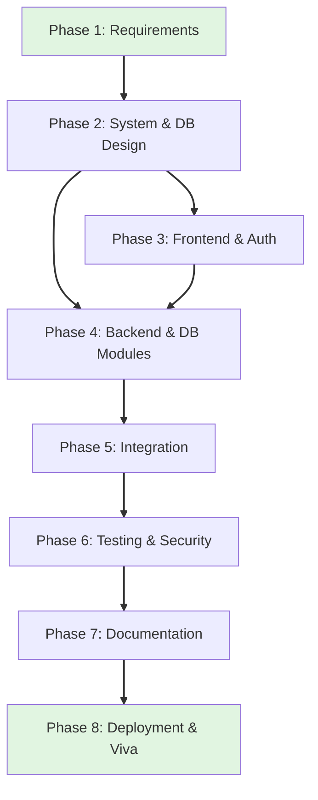

# Project Specification – EcoTrack

## 1. Project Overview

**Project title:** EcoTrack – Smart Waste Management System  
**Degree:** Bachelor of Computer Applications (BCA), 2024–2027  
**Institution:** Uttaranchal University, Dehradun  
**Type:** Academic prototype (responsive web application)  

EcoTrack is a centralized, role-based web platform that organizes the reporting and monitoring of local waste-related issues. It serves three user groups:

- **Citizens** – submit waste reports (description, category, photograph, location) and track their own submissions.
- **Administrators** – review, verify or reject reports, assign collection tasks to staff, and view dashboards/analytics.
- **Collection Staff** – view assigned tasks and update progress, completion status, and remarks.

The system is an academic prototype. It is not represented as a live municipal service or deployed production system, and it does not integrate with actual municipal authorities or waste collection services.

### Scope (in scope for initial release)
- User registration, login, logout and profile management (Citizen only via public registration; Collection Staff and Administrator accounts provisioned securely by an administrator).
- Citizen waste reporting with category, description, location and photograph upload (max 5 MB, validated file types).
- Unique report reference and submission acknowledgement.
- Administrator review: verify, reject (with reason), or update report status.
- Administrator task assignment: assign a verified report to a staff member with a target date.
- Staff task management: view assigned tasks and submit progress/completion updates with remarks.
- Citizen tracking: view status and history of own reports.
- Administrator dashboard and reports: counts and summaries by status, category, date and staff assignment.
- Recycling awareness content (educational articles on waste segregation, recycling, responsible disposal).

### Scope (out of scope / future enhancements)
- AI-based waste classification, IoT smart bins, GPS vehicle tracking, automated notifications (email/SMS), predictive analytics, recycling reward programme, mobile applications, municipal-system integration.
- These are explicitly listed as future scope in the synopsis and must not be claimed as part of the initial release.

## 2. Problem Definition

In many communities, residents lack a single structured channel to report unattended waste, overflowing bins or improper disposal, and then follow the progress of their reports. Manual calls or informal messages do not consistently capture photographs, category, exact location, assigned staff member, or completion status. Administrators struggle to prioritize reports, distribute tasks, and prepare performance summaries from scattered records.

EcoTrack addresses this with a centralized digital workflow: waste reports are registered, reviewed by an administrator, assigned to collection staff, and tracked through defined status updates.

## 3. Objectives

1. Digital reporting – simple citizen interface for submitting waste-related complaints.
2. Evidence capture – attach a photograph, select a waste category, provide location details.
3. Centralized records – searchable, consistent digital records of reports and status.
4. Administrative control – authorized administrators review reports and manage user/staff records.
5. Task coordination – administrators assign collection tasks to responsible staff.
6. Progress tracking – record task updates; complaint status visible to the submitting citizen.
7. Performance monitoring – complaint and task summaries through charts and downloadable reports.
8. Environmental awareness – practical information on waste segregation, recycling and responsible disposal.

## 4. Identification of Need

The need arises from inconsistent, informal waste-reporting channels and the absence of:
- A structured digital intake for waste complaints with evidence (photos, location).
- Role-based access separating citizen reporting, administrative review, and staff execution.
- Visibility for citizens into the status of their own reports.
- Accountability (who reviewed, who was assigned, who updated, and when).
- Aggregated performance data for administrators.

## 5. Preliminary Investigation

Investigated the existing problem context (manual/informal reporting), the three intended user groups, the technology stack named in the synopsis (Flask, MySQL, Bootstrap 5, Chart.js, Leaflet/OpenStreetMap), and the functional requirements FR1–FR12. Confirmed that a local development environment (Windows/Linux, Python 3, MySQL 8) is suitable for an academic prototype.

## 6. Technical Feasibility

- Python 3.13 and Flask 3.0 are available and well supported.
- MySQL 8 with Flask-SQLAlchemy/Flask-Migrate provides relational persistence and migrations.
- Flask-Login and Flask-WTF provide session-based authentication and CSRF protection.
- Bootstrap 5, Chart.js and Leaflet.js are CDN-delivered frontend libraries requiring no backend license.
- No external AI, payment gateway, or municipal API is required for the initial version.
- All required components run on the defined development hardware (Intel Core i3, 4 GB RAM).

## 7. Operational Feasibility

- The application is browser-based; clients need only a modern browser (Chrome, Edge, Firefox) and internet access for map tiles.
- Role-based navigation keeps each user group's interface focused.
- Staff and administrators can be trained on role-specific dashboards; citizens use a simple report form and status view.
- Deployment is local during development; HTTPS hosting proposed for production.

## 8. Economic Feasibility

- Open-source stack: Python, Flask, MySQL Community Edition, Bootstrap, Chart.js, Leaflet, OpenStreetMap – no licensing cost.
- Development hardware within suggested minimums (dual-core, 4 GB RAM, 10 GB storage).
- No paid APIs, SMS gateways, or third-party services required in the initial release.
- Hosting: local during development; low-cost Python-compatible hosting proposed for deployment.

## 9. Functional Requirements (FR1–FR12)

| ID | Requirement |
|----|-------------|
| FR1 | User registration and login: citizens and staff sign in with valid credentials; administrator accounts provisioned securely. |
| FR2 | Role-based access: pages and operations restricted by Citizen / Administrator / Staff roles. |
| FR3 | Profile management: view and update permitted profile details. |
| FR4 | Waste report submission: citizen submits category, description, date, location details. |
| FR5 | Photograph upload: permitted image formats subject to type and size validation (initial limit 5 MB). |
| FR6 | Report acknowledgement: unique report reference created and confirmation displayed. |
| FR7 | Complaint review: administrator views, verifies, rejects (with reason), or updates report status. |
| FR8 | Task assignment: administrator assigns a verified report to a staff member with a target date. |
| FR9 | Task progress: assigned staff views task details and submits progress, completion status, remarks. |
| FR10 | Citizen tracking: citizen views current status and history of own reports. |
| FR11 | Dashboard and reports: administrator views counts/summaries by status, category, date, staff assignment. |
| FR12 | Awareness content: educational information on waste segregation, recycling, responsible disposal. |

## 10. Non-Functional Requirements

| Category | Requirement |
|----------|-------------|
| Performance | Common pages and normal DB operations respond within ~3 seconds on the test environment/sample dataset. |
| Usability | Clear labels, validation messages, consistent navigation; key workflows usable on mobile screens. |
| Security | Salted password hashes; role checks and server-side input validation on protected actions. |
| File handling | Image uploads restricted by extension, detected content type and configurable size limit (5 MB initial). |
| Reliability | Validate required fields and DB relationships before saving; clear error message on failure. |
| Maintainability | Separate routes, models, templates and configuration; modular Flask blueprints. |
| Scalability | Modular design allows additional staff, locations and reports without full redesign. |
| Compatibility | Responsive UI supporting current desktop and mobile browsers. |

## 11. Hardware Requirements

| Component | Development / Server | Client (End User) |
|-----------|----------------------|-------------------|
| Processor | Intel Core i3 or equivalent; 2 cores+ | Any modern dual-core or equivalent |
| RAM | 4 GB minimum; 8 GB recommended | 2 GB minimum; 4 GB recommended |
| Storage | 10 GB free space (code, DB, test images) | Sufficient browser/device storage |
| Device/Network | Laptop/desktop with internet access | Desktop, laptop, tablet or smartphone with internet |

## 12. Software Requirements

| Category | Tool |
|----------|------|
| OS | Windows 10/11 or supported Linux |
| IDE | Visual Studio Code or Python-compatible editor |
| Runtime | Python 3.x, pip |
| Backend | Flask, Flask-Login, Flask-WTF (CSRF) |
| Database | MySQL Server + Workbench or CLI |
| Frontend | HTML5, CSS3, JavaScript, Bootstrap 5 |
| APIs/Services | Leaflet.js + OpenStreetMap tiles; Chart.js |
| Browser | Recent Chrome, Edge or Firefox |
| Version control | Git and GitHub |
| Testing | Pytest |

## 13. Main Application Workflows

1. **Citizen complaint submission** – register/login → open report form → select category → enter description & location → attach photograph → server validates fields & file → report saved → unique reference displayed → citizen tracks status.
2. **Complaint assignment** – administrator opens report queue → reviews pending reports & evidence → verifies/rejects → assigns verified report to staff with due date → task visible in staff dashboard.
3. **Task completion** – staff logs in → views assigned tasks → opens task detail → submits progress/remarks → task status updated (Pending → In Progress → Completed) → citizen/administrator views reflect latest status.
4. **Dashboard & analytics** – administrator queries aggregated counts by status/category/date/staff → Chart.js visualizations + report tables.
5. **Awareness content** – administrator maintains published articles → citizens browse and read articles.

### Administrator Panel Workflows

The administrator panel (`/admin/*`) is a premium dashboard with sidebar navigation, statistics cards, tables, charts, search and filters:

1. **Dashboard** – view statistics cards (total/pending/verified/rejected complaints, assigned/in-progress/completed/overdue tasks) and recent complaints.
2. **Complaint management** – view all complaints; search by reference; filter by category, status, and date range; view descriptions, photographs, and locations; verify pending complaints; reject complaints with mandatory reasons.
3. **Task assignment** – assign a verified complaint to an active staff member with a target date and instructions; creates a CollectionTask, links staff and assigning administrator, and updates the complaint status to Assigned.
4. **Staff management** – add staff members (securely provisioned, no public registration), view profiles and workload, activate/deactivate accounts, update details.
5. **Category management** – add, edit, and delete waste categories (cannot delete a category in use by complaints).
6. **Awareness content management** – create, edit, publish/unpublish, and delete educational articles.

All administrator routes are secured with server-side role-based authorization (`@administrator_required`). Important actions use confirmation dialogs.

### Collection Staff Portal Workflows

The collection staff portal (`/staff/*`) is a clean, mobile-friendly dashboard using Bootstrap 5:

1. **Dashboard** – view statistics cards (total/assigned/in-progress/completed/overdue tasks) and recent tasks.
2. **Task management** – view assigned tasks; search by complaint reference; filter by status; view descriptions, complaint photographs, reported addresses, administrator instructions, and target completion dates.
3. **Task progress updates** – update task status through the approved workflow (Assigned → In Progress → Completed); add remarks; every update records task ID, staff user ID, previous status, new status, remarks, and timestamp.
4. **Task completion** – marking a task completed records the completion date/time and synchronises the related complaint status to Completed, which is reflected in the citizen portal and administrator dashboard.
5. **Task history** – view the full status update history for each task.

All staff routes are secured with server-side role-based authorization (`@staff_required`). A staff member can only view and update tasks assigned to their own account — cross-staff task access is prevented.

### Analytics, Maps, and Reporting Workflows

The administrator analytics and reporting module (`/admin/analytics`, `/admin/map`, `/admin/reports/*`) provides data-driven insights using Chart.js and Leaflet.js:

1. **Analytics dashboard** – seven real-time charts powered by aggregated database queries:
   - Complaints by category (bar chart)
   - Complaints by status (doughnut chart)
   - Monthly complaint submissions (line chart)
   - Monthly resolved complaints (line chart)
   - Staff task completion performance (bar chart)
   - Pending vs completed tasks (pie chart)
   - Location-wise complaint summaries (horizontal bar chart)
   Date filters: Last 7 days, Last 30 days, Last 3 months, Custom range.
2. **Complaint location map** – Leaflet.js + OpenStreetMap integration displaying complaint markers with popups showing reference, category, status, and location. Supports filtering by status and category. Gracefully handles complaints without coordinates. Private citizen details are not exposed.
3. **Downloadable reports (CSV)** – seven report types:
   - Complaint register
   - Pending complaints report
   - Category-wise waste report
   - Location-wise waste report
   - Staff assignment and workload report
   - Task completion summary
   - Monthly activity report
   All reports use real database data and require administrator authorization.

All analytics and reporting routes are secured with server-side role-based authorization (`@administrator_required`).

## 14. Eight-Week Project Schedule

| Phase | Duration | Deliverable |
|-------|----------|-------------|
| 1. Requirement analysis | Week 1 | Problem definition, user roles, requirements list |
| 2. System and database design | Week 2 | Architecture, wireframes, DFDs, ER design |
| 3. Frontend and authentication | Week 3 | Responsive interface, login, role checks |
| 4. Backend and database modules | Weeks 3–4 | Report, user, category and task operations |
| 5. Integration | Week 5 | Connected citizen, administrator and staff workflows |
| 6. Testing and security checks | Week 6 | Test cases, resolved defects, validation checks |
| 7. Documentation | Week 7 | Project report, user guide, presentation material |
| 8. Deployment and viva preparation | Week 8 | Demonstrable build, final review, viva preparation |

Critical path (PERT): A → B → D → E → G → H, approximately 32 working days.

### Gantt Chart (Mermaid)

```mermaid
gantt
    title EcoTrack Eight-Week Project Schedule
    dateFormat  YYYY-WW
    axisFormat %w/%W
    tickInterval 1week
    section Phase 1
    Requirement analysis       :w1, 1w
    section Phase 2
    System & database design   :w2, 1w
    section Phase 3
    Frontend & authentication  :w3, 1w
    section Phase 4
    Backend & DB modules       :w3, 2w
    section Phase 5
    Integration                :w5, 1w
    section Phase 6
    Testing & security checks  :w6, 1w
    section Phase 7
    Documentation              :w7, 1w
    section Phase 8
    Deployment & viva prep     :w8, 1w
```

### PERT Chart (Mermaid)


